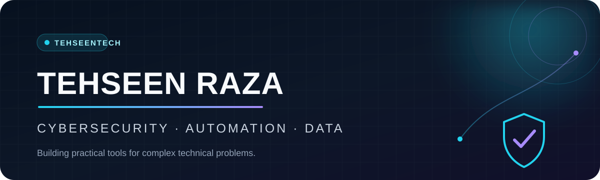

<p align="center">
  
</p>

<p align="center">
  <a href="https://github.com/TehseenTech?tab=repositories">Explore projects</a>
  ·
  <a href="https://github.com/TehseenTech/manus-skills">Manus skills</a>
  ·
  <a href="https://www.linkedin.com/in/tehseenrazahacker/">LinkedIn</a>
</p>

# Tehseen Raza

I build practical security and software systems focused on **Cybersecurity**, **Digital Forensics**, and **Network Security**.

My work turns complex technical tasks into clear, reusable tools—from digital-evidence and OSINT workflows to network-aware utilities, data dashboards, deployment systems, and responsible digital-safety resources.

> **Build responsibly. Keep the interface simple. Make the result useful.**

## Core security focus

<p>
  <strong>01 / CYBERSECURITY</strong><br />
  Building responsible security workflows, practical information-security resources, and tools that make complex technical problems easier to understand.
</p>

<p>
  <strong>02 / DIGITAL FORENSICS</strong><br />
  Preserving, organizing, and analyzing digital evidence with attention to metadata, timelines, documentation, and chain of custody.
</p>

<p>
  <strong>03 / NETWORK SECURITY</strong><br />
  Exploring network visibility, defensive controls, secure configurations, and practical approaches to reducing operational risk.
</p>

## Supporting skills

These are the security areas I study, document, and apply only in authorized, defensive, or educational contexts. Specific tools and methods vary by project; this profile does not claim certifications or production experience for every item.

`Ethical Hacking` · `Incident Response` · `Vulnerability Assessment` · `Digital Evidence Recovery` · `OSINT` · `Penetration Testing` · `Cyber Threat Analysis` · `Computer Forensics` · `Mobile Device Forensics` · `Android Security` · `Information Security` · `SIEM` · `Firewalls and IDS/IPS` · `Risk Assessment`

## Responsible security scope

All security testing and research is performed with permission and within a defined scope. My public work focuses on defensive learning, documentation, evidence preservation, privacy-aware research, and safer digital systems—not unauthorized access, credential theft, malware, or disruption.

## Current focus

- Responsible and authorized security research
- Digital evidence recovery and preservation
- OSINT and privacy-aware data tooling
- Network-security concepts and defensive workflows
- Incident response and threat-analysis documentation
- Clear documentation for technical and public-interest projects

## Featured system: Manus skills

### [Tehseen Tech Manus Skills](https://github.com/TehseenTech/manus-skills)

A public collection of reusable Manus AI agent skills for research, software development, workflow automation, data, content, design, integrations, and repeatable operations.

Each skill is organized around a real request and includes metadata, workflow guidance, resources, and discovery instructions.

**Explore:** [repository](https://github.com/TehseenTech/manus-skills) · [quickstart](https://github.com/TehseenTech/manus-skills/blob/main/docs/quickstart.md) · [skill finder](https://github.com/TehseenTech/manus-skills/blob/main/docs/skill-finder.md)

## Selected work

### [CDR Dashboard](https://github.com/TehseenTech/Cdr-dashboard-by-Tehseen-raza)

A Python and Streamlit dashboard workspace for exploring and presenting telecom call-detail data.

`Python` `Streamlit` `Data visualization`

### [Hacked Account Recovery](https://github.com/TehseenTech/hacked-account-recovery)

A safety-first guide for containing and recovering compromised WhatsApp, Instagram, Google, and social-media accounts.

`Incident response` `Account security` `Digital evidence`

### [GitHub Wrapped](https://github.com/TehseenTech/GitHub-Wrapped)

Python experiments that transform GitHub API activity into a readable developer snapshot.

`Python` `GitHub API` `CLI`

### [Personal portfolio](https://github.com/TehseenTech/Tehseenraza.github.io)

The source repository for a portfolio focused on cybersecurity, data work, technical projects, and professional presentation.

`HTML` `CSS` `SEO`

## Digital safety resources

I also maintain practical, safety-first resources for people dealing with online harm and digital evidence:

- [Digital evidence preservation](https://github.com/TehseenTech/digital-evidence-preservation) — preserving messages, screenshots, metadata, timelines, and chain of custody.
- [Online fraud and scam response](https://github.com/TehseenTech/online-fraud-scam-response) — guidance for phishing, financial fraud, evidence preservation, and reporting in Pakistan.
- [Online harassment and blackmail response](https://github.com/TehseenTech/online-harassment-blackmail-response) — practical guidance for harassment, impersonation, threats, reporting, and evidence preservation.

## Technical range

| Area | Tools and practices |
| --- | --- |
| Security and forensics | Cybersecurity, digital forensics, network security, incident response, OSINT |
| Assessment and defense | Authorized vulnerability assessment, defensive penetration testing, threat analysis, risk assessment |
| Evidence and devices | Digital evidence recovery, computer forensics, mobile device forensics, Android security |
| Product and web | JavaScript, TypeScript, React, Next.js, Node.js |
| Data and automation | Python, Streamlit, GitHub API, workflow automation |
| Platform | Linux, Docker, GitHub Actions, deployment workflows |
| AI workflows | Manus skills, reusable agent workflows, documentation and evaluation |

## How I build

```text
Understand the real problem
          ↓
Design the simplest useful solution
          ↓
Automate the repetitive parts
          ↓
Document the system clearly
          ↓
Improve it through real use
```

## Find me

- GitHub: [@TehseenTech](https://github.com/TehseenTech)
- Portfolio source: [Tehseenraza.github.io](https://github.com/TehseenTech/Tehseenraza.github.io)
- LinkedIn: [Tehseen Raza](https://www.linkedin.com/in/tehseenrazahacker/)
- Featured system: [Manus skills](https://github.com/TehseenTech/manus-skills)
- Digital forensics: [digital evidence preservation](https://github.com/TehseenTech/digital-evidence-preservation)
- Incident response: [hacked account recovery](https://github.com/TehseenTech/hacked-account-recovery)
- Projects: [browse all repositories](https://github.com/TehseenTech?tab=repositories)

---

<p align="center">
  <sub>Practical systems. Responsible technology. One useful experiment at a time.</sub>
</p>
